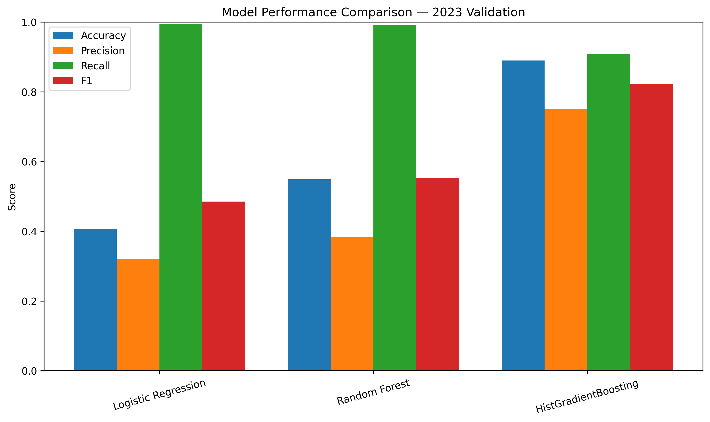
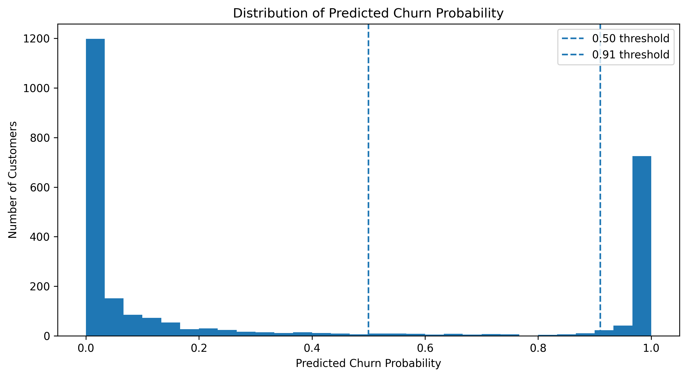
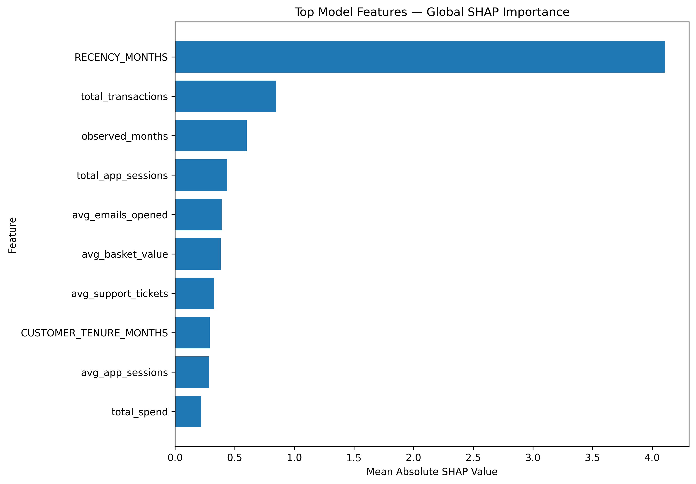
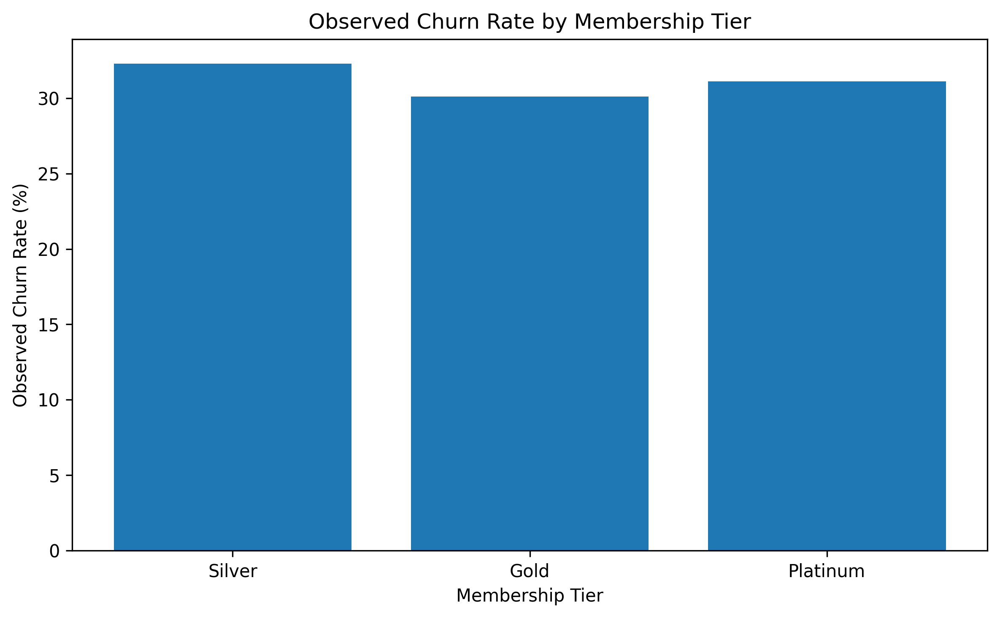
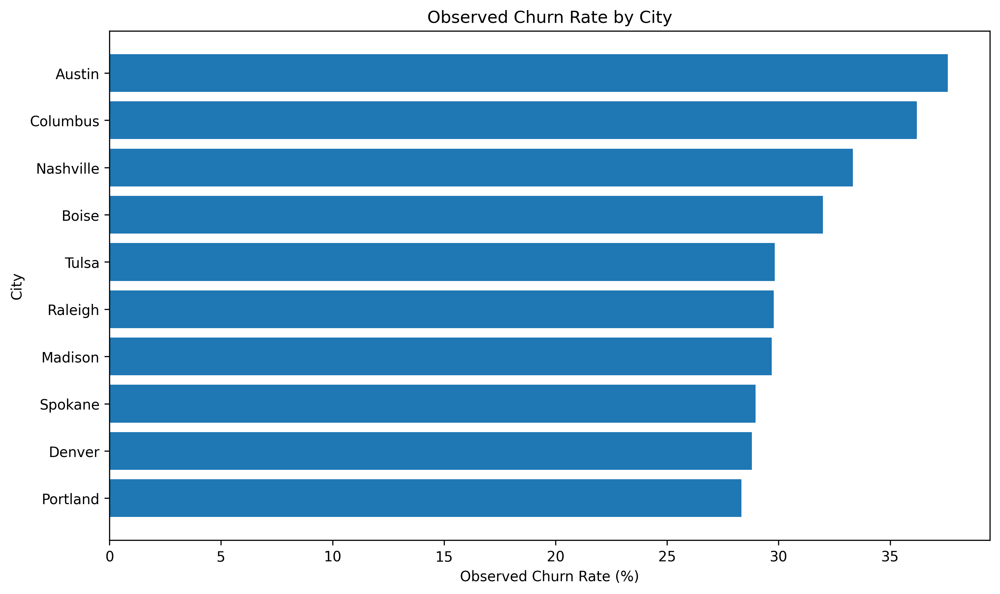
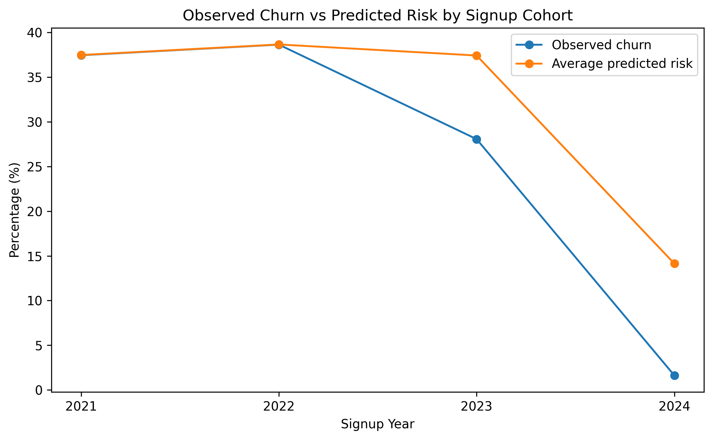

# FreshBasket Customer Churn Prediction & Retention Intelligence

## Tailwyndz Propel Internship Program — Assessment 4

An end-to-end machine learning solution for predicting customer churn in a retail loyalty program and transforming churn predictions into actionable retention insights.

The project combines customer profile information with historical purchasing activity, digital engagement, coupon usage, category behaviour, support interactions, and complaint information. A leakage-safe temporal feature engineering strategy ensures that only information available before the churn-label period is used for prediction.

The project covers the complete machine learning workflow, including data quality assessment, exploratory data analysis, feature engineering, model development, chronological validation, threshold analysis, SHAP explainability, ablation analysis, customer segmentation, customer-level predictions, and retention scenario analysis.

---

# 🎯 Business Problem

Customer churn can reduce the long-term value of a retail loyalty program. Applying the same retention strategy to every customer may result in unnecessary interventions and inefficient use of retention resources.

This project develops a predictive framework that can:

- Identify customers at higher risk of churn
- Estimate an individual customer's probability of churn
- Understand behavioural factors associated with churn
- Compare risk across customer segments
- Explain why individual customers are classified as higher risk
- Support targeted retention strategies

### Business Questions

1. Which customers are more likely to churn?
2. Which behavioural and engagement characteristics are associated with churn?
3. How does churn risk vary across membership tiers, cities, and signup cohorts?
4. Which feature groups provide the strongest predictive signal?
5. How can customer-level predictions support targeted retention interventions?

---

# 📊 Dataset Overview

The project uses approximately **2,600 loyalty customers** covering **January 2023 to June 2024** and combines three primary data sources.

## 1. Customer Profile

Contains relatively static customer information:

- Age
- Gender
- City
- Membership tier
- Marketing opt-in
- Preferred store
- Preferred category
- Home-store price tier
- Signup information
- Customer tenure

## 2. Monthly Activity

Contains historical customer behaviour:

- Transaction count
- Total spending
- Average basket value
- App sessions
- Emails opened
- Coupon redemption
- Product/category activity
- Promotional transaction behaviour
- Support tickets
- Complaints

## 3. Churn Label

Contains the customer-level outcome used for supervised learning.

A customer is labelled as churned when they have zero purchase transactions during the **April–June 2024 label period despite having earlier purchase history**.
---

# 🔐 Leakage-Safe Modelling Strategy

A major focus of the project is preventing target leakage.

Activity from the churn-label period must not be used to construct predictive features because this would allow information from the outcome period to influence the prediction.

```text
Historical Activity
Jan 2023 – Mar 2024
        │
        ▼
Feature Cutoff
31 March 2024
        │
        ▼
Feature Engineering
        │
        ▼
Churn Label Period
Apr 2024 – Jun 2024
```

# Data Quality & Preprocessing

A detailed data-quality audit was performed before modelling.

The audit covered:

- Duplicate customer records
- Duplicate customer-month activity records
- Conflicting customer-month records
- Missing demographic information
- Negative spending values
- Inconsistent categorical formatting
- Invalid or inconsistent dates
- Customer-level join coverage
- Customers with insufficient activity history

Categorical fields such as city and membership tier were standardized.

Negative spending records were investigated against transaction counts and average basket values rather than being removed blindly.

Customers without pre-label activity were retained using explicit activity indicators so that the modelling population was not unnecessarily reduced.


### Final Modelling Population

| Item | Value |
|---|---:|
| Customers | **2,600** |
| Retained Customers | **1,782 (68.54%)** |
| Churned Customers | **818 (31.46%)** |
| Predictive Features | **31** |

---

# 🔍 Exploratory Data Analysis

The exploratory analysis covered:

- Overall churn distribution
- Churn by membership tier
- Churn by city
- Churn by signup cohort
- Behavioural differences between retained and churned customers
- Spearman correlation analysis

Churned customers generally showed:

- Lower transaction frequency and total spending
- Lower app and email engagement
- Lower coupon redemption
- Lower category diversity
- Somewhat higher support activity
- Higher complaint rates

### Selected Behavioural Comparison

| Behavioural Metric | Retained | Churned |
|---|---:|---:|
| Total Transactions | 56.72 | 19.57 |
| Total Spend | 1,837.04 | 625.24 |
| Average App Sessions | 2.12 | 1.07 |
| Average Emails Opened | 1.04 | 0.67 |
| Total Coupons Redeemed | 7.37 | 3.25 |
| Complaint Rate | 4.49% | 7.64% |

> **Note:** These are observed relationships and should not be interpreted as causal effects.

---

# ⚙️ Feature Engineering

The final modelling dataset contains **31 predictive features** across four major groups.

### Customer Profile Features

- Age
- Gender
- City
- Membership tier
- Preferred store
- Preferred category
- Home-store price tier
- Signup year
- Signup month
- Customer tenure

### RFM / Purchasing Features

- Total transactions
- Total spending
- Average basket value
- Active months
- Observed months
- Purchase recency
- Historical purchase indicators
- Pre-label activity indicators

### Engagement Features

- Average app sessions
- Total app sessions
- Average emails opened
- Total emails opened
- Coupon redemption
- Category diversity
- Promotional transaction percentage

### Support Features

- Total support tickets
- Average support tickets
- Complaint count
- Complaint rate
- Complaint indicator

---

# 🤖 Machine Learning

Three classification models were evaluated.

### Logistic Regression

Used as a baseline linear classifier with class weighting to address class imbalance.

### Random Forest

Used to capture nonlinear relationships and interactions between customer characteristics and behavioural features.

### HistGradientBoosting

Used as the primary high-performing gradient-boosted tree model.

---

# 📅 Chronological Validation

Instead of using a random train-test split, a chronological cohort-based strategy was used.

| Split | Signup Cohort | Customers |
|---|---|---:|
| Training | 2021–2022 | 1,537 |
| Validation | 2023 | 816 |
| Final Temporal Holdout | 2024 | 247 |

The **2023 cohort** was used for model comparison and threshold selection.

The **2024 cohort** was retained as a final temporal holdout to evaluate the model on a later customer cohort.

The 2024 cohort contains only **4 observed churners**, so its precision, recall, and F1 metrics are interpreted cautiously.

# 📈 Model Performance

Models were evaluated on the **2023 validation cohort**.

| Model | Accuracy | Precision | Recall | F1 | PR-AUC |
|---|---:|---:|---:|---:|---:|
| Logistic Regression | 40.69% | 32.07% | 99.56% | 48.51% | 41.88% |
| Random Forest | 54.90% | 38.28% | 99.13% | 55.23% | 93.48% |
| **HistGradientBoosting** | **88.97%** | **75.09%** | **90.83%** | **82.21%** | **93.82%** |

HistGradientBoosting achieved the strongest validation performance among the evaluated models and was selected as the primary model for downstream explainability and customer-level scoring.

### Model Comparison



---

# 🎚️ Threshold Analysis

The model produces a **probability of churn** rather than only a binary prediction.

Different probability thresholds were evaluated using the **2023 validation cohort** to understand the trade-off between precision and recall.

The strongest validation F1-score was obtained at approximately **0.91**:

| Metric | Value |
|---|---:|
| Precision | ≈ 92.7% |
| Recall | ≈ 83.0% |
| F1 | ≈ 87.56% |

The **0.91 threshold** was selected using the validation cohort and was not selected using the final temporal holdout.

This threshold is therefore used for the final customer-level prediction file.

> **Important:** Threshold selection for production should ultimately consider intervention cost, customer value, false-positive cost, false-negative cost, and additional future validation data.

### Churn Probability Distribution



---

# 🔎 Explainability with SHAP

A churn prediction should provide more than a probability.

**SHAP (SHapley Additive exPlanations)** was used to identify the features contributing most strongly to the HistGradientBoosting predictions.

### Leading Global Drivers

| Rank | Feature | Business Interpretation |
|---:|---|---|
| 1 | `RECENCY_MONTHS` | Purchase recency |
| 2 | `total_transactions` | Transaction frequency |
| 3 | `observed_months` | Available customer history |
| 4 | `total_app_sessions` | Overall app engagement |
| 5 | `avg_emails_opened` | Email engagement |
| 6 | `avg_basket_value` | Basket behaviour |
| 7 | `avg_support_tickets` | Support activity |
| 8 | `CUSTOMER_TENURE_MONTHS` | Customer tenure |
| 9 | `avg_app_sessions` | Average app engagement |
| 10 | `total_spend` | Customer spending |

### Key Insight

**Purchase recency was the strongest global model driver**, followed by transaction frequency and historical engagement.

SHAP explanations were also generated at the customer level, allowing each prediction to contain the top three model-derived drivers.

These relationships represent model associations and should not be interpreted as causal effects.

### SHAP Global Importance



---

# 🧪 Ablation Study

An ablation study was conducted to understand the contribution of different feature groups.

| Feature Set | Features | F1 | PR-AUC |
|---|---:|---:|---:|
| Profile Only | 11 | 28.21% | 27.88% |
| Profile + RFM | 19 | 69.90% | 91.91% |
| **Full Behavioural** | **31** | **82.21%** | **93.82%** |

### Findings

- Profile information alone provides limited predictive signal.
- Adding RFM features produces a major improvement in predictive performance.
- Engagement and support features provide additional predictive value.
- The full behavioural feature set provides the strongest overall validation performance.

This supports the use of behavioural information as an important component of churn prediction.

---

# 👥 Segment Risk Analysis

After scoring all customers, predicted churn risk was analysed across important business segments.

## Membership Tier

| Tier | Customers | Observed Churn | Average Predicted Risk |
|---|---:|---:|---:|
| Silver | 1,474 | 32.29% | 37.57% |
| Gold | 824 | 30.10% | 33.30% |
| Platinum | 302 | 31.13% | 32.25% |

## City

Columbus and Austin showed relatively higher average predicted risk than several other cities.

| City | Customers | Observed Churn | Average Predicted Risk |
|---|---:|---:|---:|
| Columbus | 268 | 36.19% | 41.41% |
| Austin | 266 | 37.59% | 40.90% |
| Nashville | 237 | 33.33% | 37.69% |
| Boise | 247 | 31.98% | 37.15% |
| Denver | 257 | 28.79% | 33.86% |
| Madison | 256 | 29.69% | 33.83% |
| Tulsa | 295 | 29.83% | 33.56% |
| Raleigh | 282 | 29.79% | 33.32% |
| Portland | 240 | 28.33% | 32.78% |
| Spokane | 252 | 28.97% | 31.53% |

## Signup Cohort

| Signup Year | Customers | Observed Churn | Average Predicted Risk |
|---|---:|---:|---:|
| 2021 | 745 | 37.45% | 37.48% |
| 2022 | 792 | 38.64% | 38.65% |
| 2023 | 816 | 28.06% | 37.42% |
| 2024 | 247 | 1.62% | 14.13% |

The 2021 and 2022 cohorts show higher observed churn than the 2023 cohort.

The 2024 cohort shows substantially lower observed churn, but it also has substantially shorter customer histories and a higher proportion of insufficient-history customers. Therefore, direct comparison with older cohorts requires caution.

### Segment Visualizations

#### Churn by Membership Tier



#### Churn by City



#### Observed vs Predicted Churn by Signup Cohort



---

# 🎯 Customer-Level Prediction Output

A prediction is produced for all **2,600 customers**.

The final prediction file is:

```text
outputs/predictions/churn_predictions.csv
```

# 🔗 Submission Links


### Final Report

[View / Download Final Report](https://drive.google.com/file/d/1RnTvs-m8_7KrG9tAgBzkzU-Dnga7ub_H/view?usp=sharing)

### Project Presentation / Video


[Watch Project Presentation](https://drive.google.com/file/d/15AoJ__WenPf9ITEiPrMSCKFbUBT9J7YT/view?usp=drive_link)